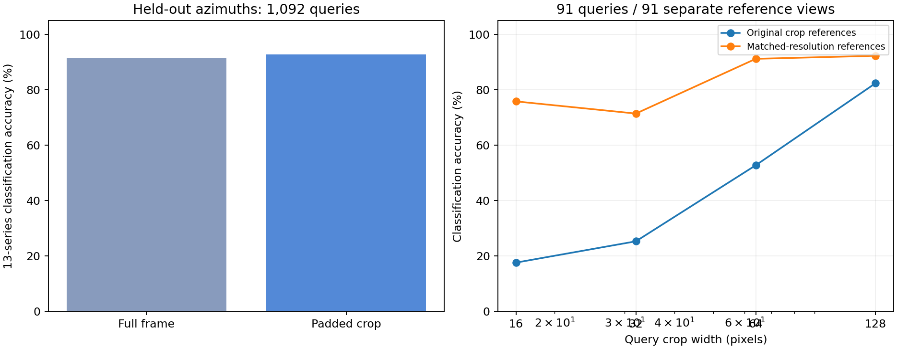

# Sim2 + MAAS vehicle sphere appearance study — 2026-10-12

[Interactive embedding explorer](embedding.html) · [Offline explorer](embedding_offline.html) · [Existing Sim2 explorer](https://fwromano.github.io/datasets/sim2-headings/embedding.html)

The new archive contains **2,184 640×640 rendered frames**, arranged as 13 series: ten paint variants of the truck, and one original Jeep, Wolf and Moose. Each has 24 azimuths at each of seven elevations: −5, 0, 18, 36, 54, 72 and 90 degrees. This is hemisphere coverage plus one slightly below-horizontal ring, not a complete lower sphere.

## Cropping and labels

The uncropped frames contain sky and ground grid. CPU YOLOv8n generated central bounding-box proposals for 1961 frames; **223 had no such proposal**. Its class labels were frequently unsuitable for these renderings (for example overhead vehicles labeled cell phone); detector classes never replace folder labels. Padded crop proposals combine detector geometry with shared paint differences for trucks and a connected green-body mask for other models. All ten truck colors share a crop rectangle at a viewpoint. Thirty images (three truck viewpoints across all colors) use reviewed overrides after paint differences picked up sparse background variation. Four cardinal contact sheets cover 364 source/crop pairs; crop proposals are not manually certified across every frame.

Filename azimuth 270 shows the front, 90 the rear and 0 the left-facing side. We use the visually inferred convention **relative heading = (270 − filename azimuth) modulo 360**, compatible with Sim2 front=0. Elevation labels follow the filenames and rendered views. The first filename parameter, 10, has unconfirmed distance units and is not used to determine observation pixels.

[Crop audit: 0°](crop-review-az0.jpg) · [90°](crop-review-az90.jpg) · [180°](crop-review-az180.jpg) · [270°](crop-review-az270.jpg) · [Bounds and source hashes](crop_index.json)

## Appearance results

The pinned `openai/clip-vit-base-patch16` revision `57c216476eefef5ab752ec549e440a49ae4ae5f3` encodes full frames and padded crops independently on CPU, without dropout or induced noise. Similarities use all 512 dimensions. The historical CLIP resize/center-crop preprocessing is retained; for elongated image crops it can focus on the middle of the body rather than the complete silhouette. Gallery azimuths are 0,30,…330; held-out queries are 15,45,…345, at every elevation and for all series. Source and crop hashes are disjoint between query and gallery.

**Full-frame accuracy: 91.48%. Cropped-frame accuracy: 92.77%.** These classify the 13 rendered model/paint series; they do not validate identity discrimination between independent same-color vehicles.

The resolution sweep uses 91 queries (one azimuth per series/elevation) and 91 separate reference views offset by 15°. LANCZOS reduces the padded crop width while retaining aspect ratio, followed by pinned CLIP preprocessing. Matched references are independently downsampled and encoded at that width. This is a controlled, narrower protocol than the full native held-out-angle test.

| Query crop width | Original crop references | Matched-resolution references |
|---|---:|---:|
| 16 | 17.6% | 75.8% |
| 32 | 25.3% | 71.4% |
| 64 | 52.7% | 91.2% |
| 128 | 82.4% | 92.3% |

## Transfer to a held-out elevation

Each of the seven elevations is queried against all six other elevations. Every crop is evaluated once (2,184 total queries per framing), with disjoint source/crop hashes. This tests view transfer rather than supplying the same elevation in the reference gallery. Overall full-frame accuracy is 88.42%; cropped-frame accuracy is 91.44%.

| Held-out elevation | Full frames | Padded crops |
|---|---:|---:|
| -5° | 82.7% | 89.7% |
| 0° | 86.2% | 92.0% |
| 18° | 83.7% | 90.1% |
| 36° | 88.1% | 89.4% |
| 54° | 90.4% | 91.3% |
| 72° | 94.2% | 92.6% |
| 90° | 93.6% | 94.9% |

[All elevation-fold predictions](elevation_holdout.json)

## Shared embedding explorer

One centered PCA basis is fitted to all 1,404 existing Sim2 Jeep features and all 2,184 new cropped scan features. The first three components show 48.06% of variation. Dataset/series, elevation and display-axis changes do not refit it. The browser only displays precomputed coordinates and bounded preview sheets. It retains three sheets with at most two concurrent image loads. The basis, row associations, models and hashes are in [projection.json](projection.json); numeric results and all predictions are in [evaluation.json](evaluation.json).

## Applying the SECTR-C camera

The camera replay uses the existing WIRE `Camera`, profile resolver and physical cuboid projection against exact retained Composer truth samples. The binding is `truck01=truck/yellow`; the person is explicitly unsupported because this archive has no person asset. For each observer/time, it computes the target-relative viewing ray and selects a discrete scan by angular distance on the sphere. At nadir, viewing-ray azimuth is degenerate; source image orientation is aligned separately to the camera-projected body forward axis. It isotropically fits/downsamples the crop into the projected physical bounds, pads remaining area, and independently encodes the resulting pixels. No upsampling or viewpoint interpolation adds detail.

The replay retained **14 image/embedding observations**. [Actual pixel crops and enlarged displays](camera/camera-crops.png) · [Camera metadata](camera/index.json) · [512D camera features](camera/embeddings.npy). The interactive explorer includes a camera crop selector. Discrete-angle/model aspect differences remain; target dimensions are authored assumptions, not measurements calibrated from this archive. The replay does not publish ROS, change MHT appearance scoring or modify the running camera feed.

## Reproduction and evidence

The source ZIP remains in SECTR-C and is identified by SHA256 `c59963a48dec9903c14d07d87e827b9317aaf5b7ceccf0ab4f825e70867ee4e9`. The public bundle contains previews, crop bounds, embeddings and evaluation evidence. UCLIP's `prepare_vehicle_scans.py`, `build_vehicle_scan_study.py`, `sample_vehicle_scan_camera.py` and `build_vehicle_scan_view.py` reproduce the stages with the recorded offline model cache and source ZIP. The crop-overrides JSON is an exported snapshot of the SECTR-C dataset review. `13` independent single-image re-encodes matched cached rows; maximum absolute feature difference was 1.19e-07. This is synthetic appearance/camera-replay evidence, not field perception validation.
